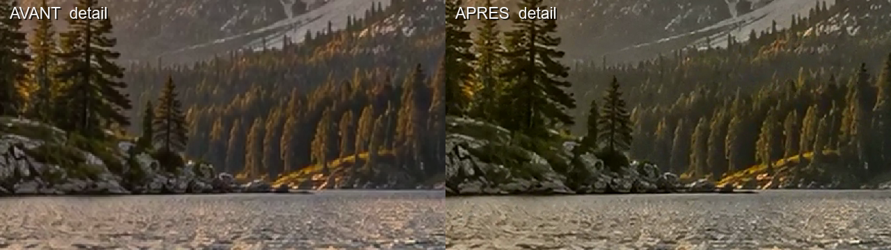
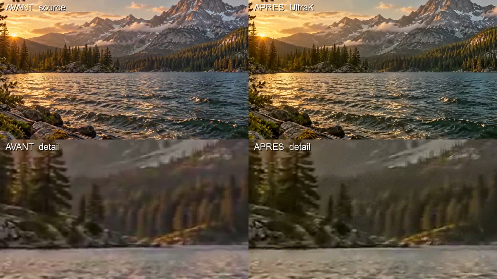
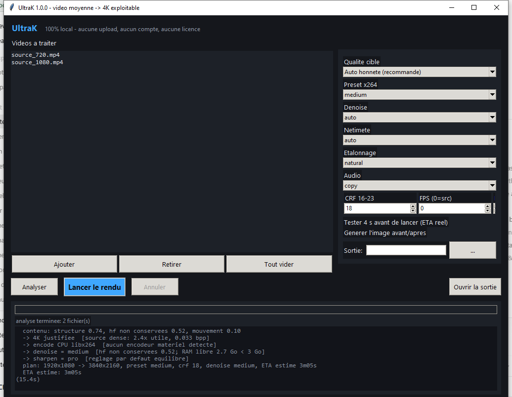

# UltraK — l'upscale 4K qui refuse de te mentir


Convertir une vidéo moyenne en « 4K pro », localement, **sans promettre des pixels qui
n'existent pas**. Pas de cloud, pas de compte, pas de téléversement : tes fichiers ne
quittent jamais ta machine.

[CI](.github/workflows/ci.yml) · [Licence MIT](LICENSE) · Python 3.8+ · Windows / Linux

---

## Le problème avec les upscaleurs « 4K »

Un fichier de téléphone à 800 kbps en 720p ne contient pas 8 mégapixels d'information.
Le coller à 3840×2160 produit un fichier 20 fois plus gros, 4 fois plus long à encoder,
et **visuellement identique**. Pire : sur une machine sans encodeur matériel, tu découvres
au bout de 40 minutes que le résultat est du flou lisse.

UltraK retourne le problème : il mesure d'abord ce que ta source contient vraiment, il
teste ta machine pendant 4 secondes, puis il choisit la sortie la plus haute **que ton
fichier et ton matériel peuvent justifier** — et il t'explique pourquoi.

## Ce qui est mesuré avant d'encoder

| Signal | Comment c'est mesuré | Ce que ça décide |
|---|---|---|
| Densité d'information | `bit_rate / (largeur × hauteur × fps)` = bits par pixel | un 4K à 0,008 bpp est une étiquette vide |
| Structure réelle | énergie haute fréquence résiduelle, puis aller-retour de downscale ×2 : ce qui survit est de la structure, ce qui disparaît est du grain | plafond de résolution honnête (720/1080/1440/2160) |
| Mouvement | score `scdet` sur 3 extraits | dose de `minterpolate` (doublage d'images) |
| Capacité GPU | **encodage réel de 3 images** avec chaque codec matériel | `hevc_nvenc` compilé ≠ supporté : le probe vire les menteurs |
| Débit machine | rendu d'extrait de 4 s, fps mesurés à l'horloge murale | ETA affiché avant que tu ne lances la vraie file |

```text
$ python ultrak.py upscale demo/source_720.mp4 --yes
  source HD (1280x720@30), 227.0 KB, 8s, bitrate 228 kbps (0.008 bpp)
  contenu: structure 0.65, hf non conservees 0.44, mouvement 0.02
  -> fausse 4K evitee: sortie plafonnee a 1440p  [0.008 bpp et detail 0.65 ne supportent pas 3.00x. Utilise --mode 4k pour forcer quand meme.]
  -> encode CPU libx264  [aucun encodeur materiel detecte]
  -> denoise = medium  [hf non conservees 0.44; RAM libre 2.7 Go < 3 Go]
  -> sharpen = pro  [reglage par defaut equilibre]
  plan: 1280x720 -> 2560x1440, preset medium, crf 18, denoise medium, ETA estime 1m22s
  preview 4s en cours...
  preview: 2.44 fps mesures sur cette machine (1m38s pour la video complete)
  >> source_720.mp4 -> 1280x720 -> 2560x1440 (libx264/medium, 1m38s estime)
     verifie: 2560x1440@30fps, 8.0s, 6.7 MB, 0.064 bpp | OK
     termine en 1m36s, 6.7 MB, 2.50 fps
```

L'estimation théorique annonçait 1m22s ; la preview mesurée l'a corrigée à **1m38s**, et le
rendu a pris **1m36s**. En 4K sur la même machine : preview 4m28s, rendu réel 4m10s.
C'est l'intérêt de tester 4 secondes plutôt que de croire un modèle.

## Ce que ça donne sur une vraie petite machine

Machine de référence : **i3-2100 (2 cœurs / 4 threads), 8 Go de RAM, Intel HD 2000,
aucun encodeur matériel**. Si ton PC a un NVenc/QSV/AMF qui marche, multiplie ces chiffres
par 5 à 10.

Source de démo : `demo/source_1080.mp4`, 1920×1080@30, 8 s, 2,1 Mo (0,033 bpp) et
`demo/source_720.mp4`, 1280×720@30, 8 s, 0,23 Mo (0,008 bpp). Les deux clips sont
regénérables avec `python tools/make_demo.py`.

| Rendu (8 s = 240 images) | Pipeline | Temps | Débit | Poids | Détail HF mesuré |
|---|---|---|---|---|---|
| 2560×1440 depuis 720p | lanczos brut | 53s | 4,53 fps | 6,6 Mo | 2,96 |
| 2560×1440 depuis 720p | **UltraK complet** | 1m35s | 2,52 fps | 6,7 Mo | **3,54 (+20 %)** |
| 3840×2160 depuis 1080p | lanczos brut | 2m27s | 1,64 fps | 15,5 Mo | 3,77 |
| 3840×2160 depuis 1080p | **UltraK complet** | 4m10s | 0,96 fps | 15,7 Mo | **4,57 (+21 %)** |

UltraK complet = `deband` + `atadenoise`/`hqdn3d` + `scale=lanczos` + `unsharp` + `cas`
+ étalonnage `eq`, en `libx264 medium crf 18`. À poids quasi identique, l'image garde
**~20 % d'énergie haute fréquence en plus** qu'un simple redimensionnement. Et la fidélité
vis-à-vis de la source reste mesurée, pas supposée :

```text
fidelite vs source (4K)   : {'psnr_y_db': 38.09, 'ssim_y': 0.9804}
fidelite vs source (1440p): {'psnr_y_db': 38.75, 'ssim_y': 0.9795}
```

~38 dB de PSNR et SSIM ≈ 0,98 : l'upscaler **révèle** ce qui était dans la source, il
n'invente pas une image différente. C'est ça la différence entre un agrandissement propre
et un modèle qui hallucine des visages.




Et quand la source ne mérite pas la 4K, le plafond honnête s'applique — même fichier,
même logiciel, sortie 1440p :



## Coût réel des options

`python ultrak bench` rend le même extrait 480p → 3840×2160 avec quatre pipelines et
enregistre le résultat dans la config (ce sont ces chiffres qui alimentent les ETA et
l'arbitrage `--budget`). Sur la machine de référence :

| Pipeline (125 images en 4K) | Débit | Temps | Taille |
|---|---|---|---|
| lanczos seul | 2,82 fps | 44,4s | 8,2 Mo |
| + denoise medium + sharpen pro | 1,24 fps | 1m41s | 10,2 Mo |
| two-step (scale en deux temps) | 1,39 fps | 1m30s | 10,2 Mo |
| + nlmeans strong (denoise lourd) | 0,74 fps | 2m50s | 9,3 Mo |

Deux décisions de conception en découlent directement : le two-step n'est payant qu'au-delà
de 2,5× d'agrandissement, et `nlmeans` n'est proposé que si la source est petite **et** que
la RAM libre le permet — sinon il coûte 2,4× le temps pour un gain invisible.

## Installer

### Windows, un clic

1. Télécharge et décompresse [la dernière release](https://github.com/ck526438-lgtm/ultrak/releases).
2. Double-clique **`Launch.bat`**.

Le lanceur cherche Python (3.8+), ouvre la fenêtre, et télécharge ffmpeg (~100 Mo, une
seule fois, dans `~/.ultrak/bin`) si besoin. Tu peux aussi **glisser des vidéos sur
`Launch.bat`** : elles arrivent préchargées dans la file.



### En ligne de commande

```bash
git clone https://github.com/ck526438-lgtm/ultrak.git && cd ultrak
python ultrak.py doctor            # état de la machine, capacités ffmpeg
python ultrak.py install-ffmpeg    # seulement si aucun ffmpeg trouvé
# ou, pour avoir la commande `ultrak` partout :
python -m pip install -e .
```

Aucune dépendance Python : bibliothèque standard + ffmpeg.

## Utiliser

### Fenêtre

Glisse tes fichiers, choisis **Auto honnête**, lance. La barre de progression donne les
images rendues, le débit réel et le temps restant mesurés (pas extrapolés), et le journal
explique chaque décision. « Tester 4 s avant de lancer » est coché par défaut : c'est ce
qui remplace l'estimation théorique par un vrai débit.

### CLI

```bash
python ultrak.py analyze video.mp4                    # mesure et propose, sans encoder
python ultrak.py upscale *.mp4 --out sortie/          # file adaptative, parallélisée
python ultrak.py upscale clip.mp4 --budget 30         # s'adapte pour finir en 30 min max
python ultrak.py upscale clip.mp4 --fps 50 --smooth   # doublage d'images interpolé
python ultrak.py upscale clip.mp4 --mode 4k           # forcer la 4K (et tu sauras pourquoi c'est du vent)
python ultrak.py compare in.mp4 out.mp4 --gif --metrics
python ultrak.py bench                                # étalonne TA machine, fiabilise les ETA
```

Options utiles : `--preset`, `--crf`, `--denoise none|light|medium|strong`,
`--sharpen none|soft|pro|strong`, `--grade none|natural|punch`, `--audio copy|aac|none`,
`--jobs N`, `--dry-run`, `--no-preview`, `--poster`.

### Ce qui se passe sous le capot

1. `probe` : géométrie, rotation, durée, débit, audio.
2. `measure_content` : structure / hautes fréquences / mouvement sur 3 extraits.
3. `plan` : résolution, codec, denoise, netteté, étalonnage, plafond de bits-par-pixel.
4. `preview` : 4 secondes rendues pour mesurer le débit réel de cette machine.
5. `tune_to_budget` : si ton budget temps est dépassé, on descend le preset **puis** la
   résolution — et la décision est écrite dans le journal, jamais silencieuse.
6. Rendu avec `-progress pipe:1` (fps et ETA en direct), fichier temporaire `.ultrak-part.mp4`
   renommé seulement à la fin, reprise de file via manifeste, annulation propre.
7. `verify` : géométrie, durée, bits-par-pixel, intégrité audio du fichier sorti.

L'ordre du graphe de filtres est le vrai gain de perf : `fps` et denoise tournent à la
résolution **source** (le dénoiseur a 4× moins de pixels à traiter qu'après l'agrandissement),
puis `scale`, puis netteté et étalonnage à la résolution cible.

## Limites assumées

- **Sans encodeur matériel, la 4K est lente.** 1 fps sur un i3-2100 : le logiciel ne
  défie pas le silicium, il te le dit avant que tu lances la file.
- **Il n'y a pas d'IA de génération de détail.** Pas de Real-ESRGAN : ces modèles
  pèsent plusieurs Go, demandent un GPU, et réécrivent l'image. UltraK reste dans le
  domaine mesurable — ce choix est délibéré, et discuté dans [CONTRIBUTING.md](CONTRIBUTING.md).
- **Les métriques de contenu sont heuristiques.** Elles séparent structure et grain via
  un aller-retour de résolution ; elles se trompent sur une source déjà très bruitée.
  Dans ce cas, `--mode` et `--denoise` restent accessibles.
- **`guided` est absent** des builds ffmpeg « essentials » : le pipeline ne l'utilise pas.

## Développement

```bash
python -m pytest -q                  # 33 tests unites + 8 tests d'integration ffmpeg
python tools/lint_filters.py ffmpeg  # chaque chaine de filtre validee contre le binaire
```

Le lint des filtres a été écrit après un `deband=1:1:6:8` hors intervalle qui faisait
échouer 100 % des rendus. Les 41 tests passent en CI sur Linux et Windows, Python 3.8 à 3.12.

## Licence

MIT — voir [LICENSE](LICENSE).
